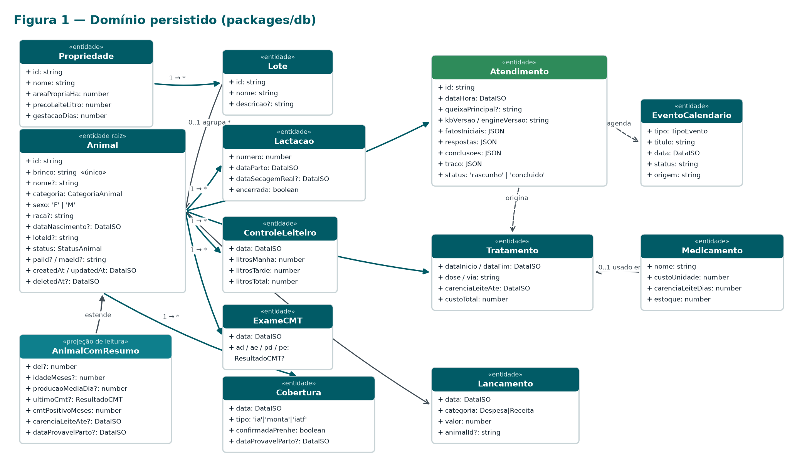
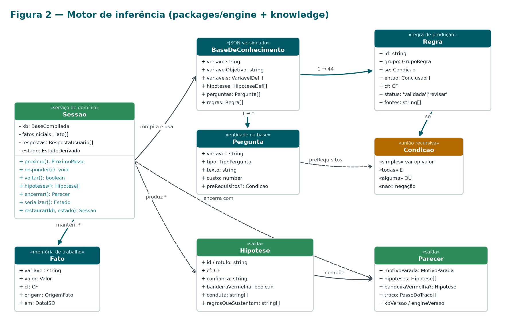
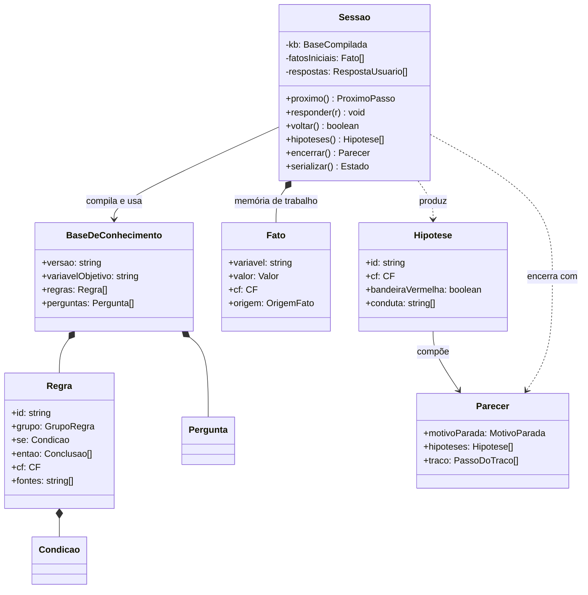
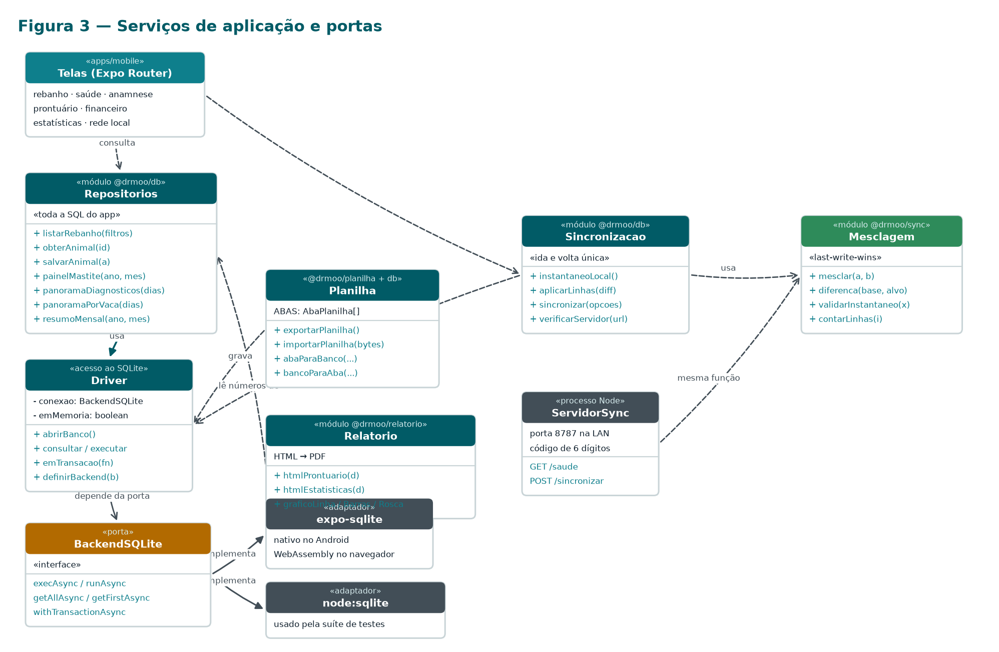

# Diagrama de classes

As figuras deste capítulo são geradas por `scripts/gerar_diagrama_classes.py` e também saem num
arquivo próprio, `docs/DrMoo-DiagramaDeClasses.docx`, em paisagem — mais confortável para
imprimir e para projetar.

| Traço | Significado |
|---|---|
| Linha cheia com ponta fechada | composição: a parte não existe sem o todo (um exame pertence a um animal) |
| Linha cheia com ponta aberta | associação: uma classe conhece a outra |
| Linha tracejada | dependência: uma usa a outra sem guardar referência |
| Ponta fechada partindo de uma «porta» | realização: o adaptador implementa a interface |

---

## 1. Domínio persistido

`Animal` é a raiz: tudo que acontece no curral pendura nele. O **brinco** é a identidade pública
(única, usada pela planilha, pela busca e pela sincronização); o `id` é interno.

| Classe | Papel | Observação |
|---|---|---|
| `Propriedade` | parâmetros da fazenda | linha única; preço do leite e gestação alimentam os cálculos |
| `Lote` | grupo de manejo | referenciado pelo **nome** na planilha |
| `Animal` | raiz do domínio | exclusão lógica (`deleted_at`) para a sincronização propagar |
| `AnimalComResumo` | projeção de leitura | **não é tabela**: resultado da consulta com DEL, produção, CMT e carência |
| `Lactacao` | partos e secagens | define o DEL e a lactação corrente |
| `ControleLeiteiro` | pesagem por vaca | base da produção individual |
| `ExameCMT` | CMT por quarto mamário | `N, T, 1, 2, 3, PP` |
| `Atendimento` | anamnese gravada | guarda fatos, respostas, conclusões e traço em JSON |
| `Tratamento` | remédio aplicado | custo e carência — entram na análise tratamentos × leite |
| `Medicamento` | estoque e carências | referenciado pelo **nome** |
| `EventoCalendario` | calendário sanitário | gerado por tratamento, triagem ou manualmente |
| `Lancamento` | despesa ou receita | categorias da planilha Embrapa |
| `Cobertura` | IA, monta ou IATF | origina a data provável do parto |

---

## 2. Motor de inferência

`Sessao` é a única classe com estado do motor — e não conhece banco, tela nem rede. Recebe a base
compilada e os fatos, e devolve a próxima pergunta ou o parecer.

| Classe | Papel |
|---|---|
| `Sessao` | ciclo perguntar → responder → concluir, com `voltar()` e serialização para o prontuário |
| `BaseDeConhecimento` | o JSON versionado: variáveis, hipóteses, perguntas e as 44 regras |
| `Regra` | regra de produção `SE condição ENTÃO conclusão (CF)`, com fonte e status |
| `Condicao` | união recursiva: simples, `todas`, `alguma`, `nao` |
| `Pergunta` | o que perguntar, de que tipo, a que custo e sob quais pré-requisitos |
| `Fato` | item da memória de trabalho: variável, valor, CF e origem |
| `Hipotese` | diagnóstico com CF, rótulo de confiança, conduta e regras que o sustentam |
| `Parecer` | saída final: hipóteses, bandeira vermelha, traço e versões |

Em Mermaid, para quem quiser editar:

---

## 3. Serviços de aplicação e portas

| Módulo | Papel |
|---|---|
| `Repositorios` | toda a SQL do app; devolve projeções prontas para a tela |
| `Driver` | abre o SQLite, serializa transações e injeta o backend |
| `BackendSQLite` | **porta** de cinco métodos que isola a tecnologia |
| `expo-sqlite` / `node:sqlite` | adaptadores: aparelho e navegador; suíte de testes |
| `Sincronizacao` | instantâneo local, diferença e gravação do que veio do outro aparelho |
| `Mesclagem` | *last-write-wins* comutativo e idempotente, usado nos **dois** lados |
| `ServidorSync` | processo Node na LAN: `/saude` e `/sincronizar`, com código de pareamento |
| `Planilha` | mapa aba ↔ tabela, leitura e escrita do `.xlsx` |
| `Relatorio` | HTML e gráficos SVG que viram PDF no app |

---

## 4. Por que o modelo é assim

**O brinco é a identidade pública, o id é a interna.** Planilha, busca e sincronização conversam
pelo brinco do animal e pelo nome do lote, do medicamento e da vacina — é o que o produtor
conhece. Id em planilha é convite a erro silencioso.

**`AnimalComResumo` não é tabela.** É o resultado de uma consulta única com subconsultas
correlacionadas. Agregar em SQL e não em JavaScript é decisão de desempenho: o aparelho-alvo tem
2 GB de RAM.

**O atendimento guarda JSON de propósito.** Fatos, respostas, conclusões e traço são a fotografia
do raciocínio: permitem **re-executar** o motor depois e provar que o mesmo caso dá o mesmo
parecer — e detectar quando a base mudou de versão.

**`BackendSQLite` é uma porta.** O driver conhece uma interface de cinco métodos, não o
`expo-sqlite`. É isso que deixa a suíte rodar contra SQLite real no Node, sem navegador nem
aparelho, e o que permitiu à segunda aba do navegador cair para um banco em memória sem que nada
acima percebesse.

**Exclusão é lógica onde a sincronização precisa.** Sem a lápide `deleted_at`, o registro apagado
num aparelho voltaria do outro na sincronização seguinte.

**A mesclagem é a mesma função nos dois lados.** Servidor e aparelho chamam `mesclar()` do mesmo
pacote: é o que garante que os aparelhos convergem, independentemente da ordem.
